# Relazione Tecnica Completa e Replica Sperimentale in LTspice
## *"A Novel ZVZCS Full-Bridge DC/DC Converter Used for Electric Vehicles"*
**Riferimento Articolo:** M. Pahlevaninezhad, P. Das, J. Drobnik, P. K. Jain, A. Bakhshai, *IEEE Transactions on Power Electronics*, Vol. 27, No. 6, pp. 2752–2769, Giugno 2012.

---

## Indice Generale
1. [Inquadramento dell'Applicazione e Obiettivi del Paper](#1-inquadramento-dellapplicazione-e-obiettivi-del-paper)
2. [Problematiche del Convertitore Full-Bridge Convenzionale (Fig. 1)](#2-problematiche-del-convertitore-full-bridge-convenzionale-fig-1)
3. [Architettura della Nuova Topologia ZVZCS Proposta (Fig. 2)](#3-architettura-della-nuova-topologia-zvzcs-proposta-fig-2)
4. [Analisi Passo-Passo dei 7 Modi Operativi (Eq. 1–15, Fig. 3–5)](#4-analisi-passo-passo-dei-7-modi-operativi-eq-115-fig-35)
5. [Analisi di Regime Stazionario e Guadagno in Tensione (Eq. 16–19, Fig. 6–7)](#5-analisi-di-regime-stazionario-e-guadagno-in-tensione-eq-1619-fig-67)
6. [Procedura di Progetto e Dimensionamento dei Componenti Chiave (Eq. 20–32, Fig. 8–11)](#6-procedura-di-progetto-e-dimensionamento-dei-componenti-chiave-eq-2032-fig-811)
7. [Implementazione Circuitale in LTspice: Guida ai File `.asc` e `.plt`](#7-implementazione-circuitale-in-ltspice-guida-ai-file-asc-e-plt)
8. [Replica Completa delle Simulazioni e Confronto Passo-Passo con i Risultati Sperimentali (Fig. 14–23)](#8-replica-completa-delle-simulazioni-e-confronto-passo-passo-con-i-risultati-sperimentali-fig-1423)
9. [Tabella Riassuntiva di Tutte le Misure Estratte da LTspice (`.meas`)](#9-tabella-riassuntiva-di-tutte-le-misure-estratte-da-ltspice-meas)
10. [Domande Tipiche d'Esame Orale e Risposte Tecniche Dettagliate](#10-domande-tipiche-desame-orale-e-risposte-tecniche-dettagliate)

---

## 1. Inquadramento dell'Applicazione e Obiettivi del Paper

Nei veicoli elettrici (EV) e ibridi plug-in (PHEV), il caricabatterie di bordo (*on-board battery charger*) preleva energia dalla rete elettrica AC monofase ($170\text{--}267\text{ V}_{AC}$) per caricare il pacco batterie di trazione ad alta tensione ($235\text{--}431\text{ V}_{DC}$) fino a una potenza nominale di $3\text{ kW}$.

Come mostrato nello schema a blocchi del sistema completo (Fig. 12 del paper), il convertitore AC/DC è costituito da due stadi in cascata:
1. **Primo Stadio AC/DC (PFC Boost Interleaved a 2 fasi, $f_{sb} = 50\text{ kHz}$):** raddrizza la tensione di rete tramite un ponte a diodi (`20ETF06pbF`), assicura un fattore di potenza unitario ($PF > 99\%$) e regola il bus continuo intermedio al valore nominale $V_{dc} = 400\text{ V}$ su un condensatore di bus $C_{bus} = 1.4\text{ mF}$.
2. **Secondo Stadio DC/DC Isolato (Full-Bridge ad Alta Frequenza, $f_{sf} = 220\text{ kHz}$):** fornisce l'isolamento galvanico richiesto dagli standard automobilistici tra la rete elettrica e la batteria di trazione e regola la corrente/tensione di carica della batteria.

### Le Sfide Tecniche Fondamentali nella Ricarica EV
Il convertitore DC/DC a ponte intero (*Full-Bridge*) deve soddisfare simultaneamente tre requisiti estremamente stringenti:
1. **Funzionamento sicuro da pieno carico ($3\text{ kW}$) fino a carico rigorosamente nullo (*No-Load*, $0\text{ W}$):** quando la batteria di trazione raggiunge il $100\%$ dello stato di carica (fine carica in modalità *trickle/float*), il convertitore può rimanere connesso alla rete per ore erogando corrente nulla. Deve quindi mantenere la commutazione a tensione zero (**ZVS**) anche a vuoto assoluto ($I_o = 0\text{ A}$).
2. **Eliminazione degli spike di tensione sui diodi del raddrizzatore d'uscita:** ad alta frequenza ($220\text{ kHz}$) e alta tensione d'uscita ($300\text{--}431\text{ V}$), i convertitori Full-Bridge convenzionali soffrono di violente sovratensioni (*voltage spikes*) sui diodi secondari, che costringono a sovradimensionare i diodi (usando diodi da $1200\text{ V}$ per un'uscita da $300\text{--}400\text{ V}$) e degradano pesantemente il rendimento e le emissioni EMI.
3. **Eliminazione della modalità di ricircolo (*Freewheeling Mode*) e del recupero inverso (*Reverse Recovery*):** per massimizzare il rendimento fino a $3\text{ kW}$ riducendo al minimo le perdite di conduzione e commutazione.

---

## 2. Problematiche del Convertitore Full-Bridge Convenzionale (Fig. 1)

Nel convertitore Full-Bridge Phase-Shift (PSFB) convenzionale alimentato in tensione con filtro d'uscita induttivo $L_f$ (Fig. 1 del paper):

1. **Perdita dello ZVS a Carichi Leggeri e a Vuoto:**
   - Nei convertitori PSFB convenzionali, lo ZVS dei MOSFET è ottenuto sfruttando l'energia magnetica immagazzinata nell'induttanza di dispersione $L_{leak}$ del trasformatore per scaricare le capacità parassite d'uscita $C_{oss}$ dei MOSFET durante il *dead-time* $t_d$:
     $$\frac{1}{2} L_{leak} I_{pri}^2 \ge C_{so} V_{dc}^2$$
   - A carichi leggeri o a vuoto ($I_{pri} \to 0$), l'energia in $L_{leak}$ è insufficiente. La perdita dello ZVS a $220\text{ kHz}$ causa la scarica dissipativa brusca di $C_{so}$ nel canale del MOSFET all'accensione, generando enormi perdite di commutazione, elevatissimo $di/dt$, disturbi EMI sul circuito di gate drive e rischio di *shoot-through* distruttivo del ramo.
   - Anche aggiungendo un circuito ausiliario passivo a un PSFB convenzionale (come in [22], Tabella V del paper), il **Leading Leg** deve compensare la corrente riflessa dell'induttore di filtro d'uscita $L_f$, richiedendo una corrente reattiva ausiliaria doppia rispetto al **Lagging Leg** ($L_{AUXA} = 33\ \mu\text{H}$ contro $L_{AUXB} = 67\ \mu\text{H}$, con $I_{PA} \approx 6.8\text{ A}$), aumentando le perdite di conduzione.

2. **Connessione in Serie di Due Generatori di Corrente (Origine degli Spike di Tensione):**
   - Nel raddrizzatore *voltage-driven* convenzionale (Fig. 1), il ponte a diodi secondario collega direttamente l'induttanza di dispersione del trasformatore $L_{leak}$ con l'induttore di filtro d'uscita $L_f$.
   - Poiché sia $L_{leak}$ sia $L_f$ si comportano istantaneamente come generatori di corrente, durante le transizioni di commutazione dei diodi si verifica un conflitto induttivo che, interagendo con le capacità di giunzione e la carica di recupero inverso ($Q_{rr}$) dei diodi, innesca violente oscillazioni parassite e **spike di tensione superiori a $600\text{--}750\text{ V}$** (come dimostrato sperimentalmente e in LTspice in Fig. 14a e Fig. 14b).

3. **Modalità di Freewheeling (Ricircolo di Corrente a Tensione Zero):**
   - Quando la tensione d'uscita del ponte inverter $v_{AB}$ passa a $0\text{ V}$ (o durante l'inversione della corrente in $L_{leak}$), tutti e quattro i diodi del ponte secondario conducono simultaneamente cortocircuitando il secondario ($v_{sec} = 0\text{ V}$). Durante questo intervallo di *freewheeling*, una forte corrente circola nel primario e nel secondario senza trasferire potenza attiva al carico, riducendo drasticamente il *duty-cycle* effettivo e l'efficienza a pieno carico.

---

## 3. Architettura della Nuova Topologia ZVZCS Proposta (Fig. 2)

La topologia proposta da Pahlevaninezhad et al. (Fig. 2 del paper) risolve alla radice tutti i problemi precedenti attraverso tre innovazioni strutturali:

1. **Raddrizzatore Pilotato in Corrente (*Current-Driven Rectifier*) con Condensatore di Clamping $C_f$:**
   - Sul lato primario è inserito un induttore serie equivalente $L_{seq} = L_s + L_{leak} = 11.8\ \mu\text{H}$ (integrato direttamente come induttanza di dispersione controllata del trasformatore, più un condensatore di blocco DC $C_b$ per evitare la saturazione del nucleo).
   - Sul lato secondario, **immediatamente a valle del ponte a diodi ($D_1 \div D_4$)** è posto il condensatore di filtro $C_f = 1\ \mu\text{F}$ (seguito poi dall'induttore di filtro $L_f = 80\ \mu\text{H}$ verso la batteria).
   - L'induttore serie primario $L_{seq}$ agisce come un **generatore di corrente** che alimenta il ponte a diodi, mentre il condensatore $C_f$ agisce come un **generatore di tensione** che **fissa (*clampa*) istantaneamente la tensione inversa sui diodi del ponte al valore della tensione d'uscita $V_o = 300\text{ V}$**, eliminando qualsiasi spike di tensione! Ciò consente di impiegare diodi Schottky in Carburo di Silicio (SiC) da soli **$600\text{ V}$** (`CPW-0600-S010B`) anziché diodi da $1200\text{ V}$.

2. **Conduzione Discontinua (DCM) / Critica (CRM) dell'Induttore Serie $L_{seq}$:**
   - L'induttore serie $L_{seq} = 11.8\ \mu\text{H}$ è progettato per operare in **Conduzione Critica (CRM)** a pieno carico ($3\text{ kW}$) e in **Conduzione Discontinua (DCM)** per tutti i carichi inferiori ($0\% \div 99\%$).
   - Di conseguenza, in ogni semiciclo la corrente primaria $i_s(t)$ **scende naturalmente a zero prima dell'inizio del semiciclo successivo** (Modo VI $\to$ Modo VII):
     - I diodi del ponte d'uscita ($D_1, D_4$ o $D_2, D_3$) **si spengono naturalmente a Corrente Zero (ZCS)**, azzerando le perdite di *reverse recovery*.
     - La modalità di *freewheeling* è **completamente eliminata** su tutto il range di carico.
     - Gli interruttori del **Leading Leg ($S_1, S_2$)** si spengono a **Corrente quasi Zero (ZCS)** e si accendono a **Tensione Zero e Corrente Zero (ZVZCS)**!

3. **Circuiti Ausiliari Passivi Completamente Simmetrici ($L_{AUX1} = L_{AUX2} = 67\ \mu\text{H}$):**
   - Poiché la corrente primaria $i_s(t)$ è **sempre zero** nell'istante in cui commuta il Leading Leg ($S_1, S_2$), il circuito ausiliario del Leading Leg deve fornire unicamente la piccola corrente reattiva necessaria a caricare/scaricare le capacità d'uscita $C_{so}$ dei MOSFET durante il tempo morto $t_d$.
   - Pertanto, entrambi i rami del ponte richiedono la **stessa identica corrente reattiva**, permettendo due circuiti ausiliari **perfettamente simmetrici**:
     - Partitore capacitivo $C_{a1} = 2.2\ \mu\text{F}$ (che fissa il punto medio a $V_{dc}/2 = 200\text{ V}$);
     - Induttore ausiliario $L_{AUX1} = L_{AUX2} = 67\ \mu\text{H}$ connesso tra il punto medio del partitore e il nodo centrale del ramo ($A$ o $B$).

---

## 4. Analisi Passo-Passo dei 7 Modi Operativi (Eq. 1–15, Fig. 3–5)

Grazie alla simmetria del circuito, l'analisi di un intero periodo di commutazione $T_s = 1/f_s = 4.545\ \mu\text{s}$ (diviso in 14 modi) è descritta completamente analizzando i **7 modi operativi di un semiciclo** ($t_0 \le t \le t_7$, di durata $T_s/2 = 2.273\ \mu\text{s}$):

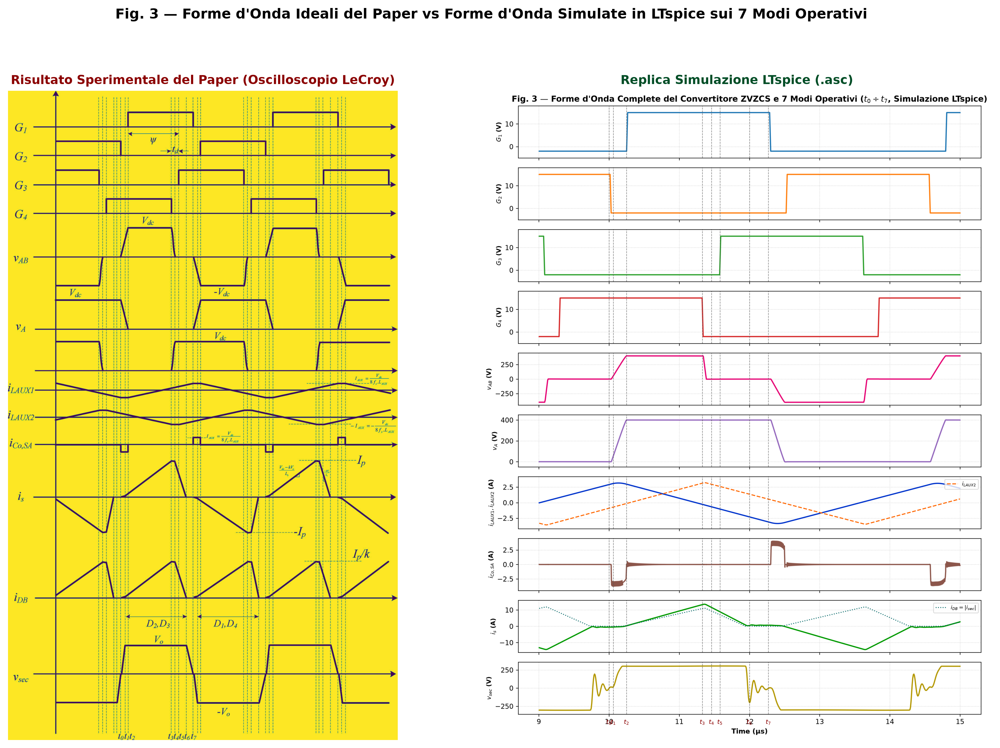

### Modo I ($t_0 \le t \le t_1$) — Inizio Commutazione Leading Leg a Corrente Primaria Quasi Nulla
- All'istante $t = t_0$, il MOSFET inferiore del Leading Leg $S_2$ viene spento ($G_2 \to 0$, mentre $S_4$ sul Lagging Leg è già acceso, quindi $v_B = 0$).
- Poiché nel modo precedente (Modo VII) la corrente primaria $i_s$ era scesa a zero, lo spegnimento di $S_2$ avviene in condizioni di **quasi-ZCS**.
- La corrente dell'induttore ausiliario del Leading Leg $i_{AUXA}(t_0) = +I_{PA} = +3.39\text{ A}$ (costante durante il breve tempo morto) scarica la capacità d'uscita $C_{s1}$ di $S_1$ e carica $C_{s2}$ di $S_2$:
  $$v_{Cso}(t) = V_{dc} - \frac{I_{PA}}{2 C_{so}}(t - t_0), \qquad v_{AB}(t) = V_{dc} - v_{Cso}(t) = \frac{I_{PA}}{2 C_{so}}(t - t_0) \quad \text{(Eq. 2–3)}$$
- Durante questo primo sotto-intervallo, la tensione secondaria non ha ancora raggiunto $V_o + 2V_d$, perciò i diodi d'uscita sono polarizzati inversamente (OFF) e nel primario scorre una corrente trascurabile attraverso $L_s + L_{leak} + L_M$:
  $$i_s(t) = \frac{1}{L_s + L_{leak} + L_M}\int_{t_0}^{t} v_{AB}\,dt = \frac{I_{PA}}{4(L_s + L_M + L_{leak})C_{so}}(t - t_0)^2 \quad \text{(Eq. 1, 4)}$$
- Il Modo I termina a $t = t_1$ quando la tensione sul secondario raggiunge $V_o + 2V_d$:
  $$t_1 = t_0 + \frac{2k(V_o + 2V_d)(L_s + L_M + L_{leak})C_{so}}{L_M \cdot I_{PA}} \quad \text{(Eq. 5)}$$

### Modo II ($t_1 \le t \le t_2$) — Polarizzazione Diretta dei Diodi Secondari e Completamento Scarica ZVS di $S_1$
- A $t = t_1$, i diodi secondari $D_2, D_3$ entrano in conduzione fissando la tensione riflessa sul primario del trasformatore a $k(V_o + 2V_d) \approx 256\text{ V}$.
- La capacità $C_{s1}$ di $S_1$ continua a scaricarsi tramite $I_{PA}$ fino ad azzerare la tensione $v_{DS,S1}$ all'istante $t_2$:
  $$i_s(t) = \frac{I_{PA}}{4(L_s + L_{leak})C_{so}}(t - t_1)^2 - \frac{k(V_o + 2V_d)}{L_s + L_{leak}}(t - t_1) \quad \text{(Eq. 6–8)}$$
  $$t_2 = t_0 + \frac{2 V_{dc} C_{so}}{I_{PA}} = t_0 + t_d \quad \text{(Eq. 9)}$$
- All'istante $t_2$, la tensione ai capi di $S_1$ è zero e la corrente $i_s(t_2)$ è ancora prossima a zero.

### Modo III ($t_2 \le t \le t_3$) — Accensione ZVZCS di $S_1$ e Trasferimento di Potenza Attiva
- A $t = t_2$, viene applicato l'impulso di gate $G_1$ a $S_1$, che si accende a **Tensione Zero e Corrente quasi Zero (ZVZCS)**!
- Durante tutto l'intervallo $[t_2, t_3]$, $S_1$ e $S_4$ conducono ($v_{AB} = +V_{dc} = +400\text{ V}$) mentre il secondario è fissato da $C_f$ a $V_o + 2V_d$. Ai capi dell'induttanza serie equivalente $L_{seq} = L_s + L_{leak} = 11.8\ \mu\text{H}$ è applicata la tensione costante positiva $V_{dc} - k(V_o + 2V_d) \approx 143.8\text{ V}$.
- La corrente primaria $i_s(t)$ cresce quindi linearmente con pendenza $+12.18\text{ A/}\mu\text{s}$ fino a raggiungere il valore di picco $I_p$ all'istante $t_3$:
  $$i_s(t) = \frac{V_{dc} - k(V_o + 2V_d)}{L_s + L_{leak}}(t - t_2) \quad \text{(Eq. 10)}$$
  $$t_3 = t_2 + \frac{\psi}{\omega_s} - t_d \quad \text{(Eq. 12)}$$
  dove $\psi$ è l'angolo di *phase-shift* tra il Leading Leg e il Lagging Leg, e il valore di picco $I_p = i_s(t_3)$ è dato dall'Eq. (11).

### Modo IV ($t_3 \le t \le t_4$) — Spegnimento di $S_4$ e Transizione ZVS del Lagging Leg ($S_3, S_4$)
- A $t = t_3$, il segnale di gate $G_4$ viene portato a zero spegnendo $S_4$ (grazie a $C_{s4}$, lo spegnimento avviene in soft-switching).
- La somma della corrente primaria $i_s(t) \approx I_p$ e della corrente dell'induttore ausiliario del Lagging Leg $i_{AUXB}(t_3) = +I_{PB} = +3.39\text{ A}$ scarica rapidamente la capacità $C_{s3}$ di $S_3$ e carica $C_{s4}$ di $S_4$ fino a $V_{dc}$, portando $v_{AB}(t)$ da $+V_{dc}$ a $0\text{ V}$:
  $$v_{AB}(t) = V_{dc} - V_{dc}\sin\left(\frac{t - t_3}{\sqrt{2 C_{so}(L_s + L_{leak})}}\right) - \frac{I_{PB}}{2 C_{so}}(t - t_3) \quad \text{(Eq. 13)}$$
- **Comportamento a Carichi Leggeri (Fig. 5 del paper):** a carichi molto bassi (es. $10\%$ del carico), il picco $I_p$ è piccolo e la corrente $i_s(t)$ si annulla prima che $C_{s3}$ sia completamente scarico. Di conseguenza, il fronte di discesa di $v_{AB}$ presenta **due pendenze distinte** (riprodotte fedelmente in LTspice nella Fig. 5): una prima pendenza più ripida determinata da $I_p + I_{PB}$ ($t_3 \le t \le t_{3,4}$) e una seconda pendenza determinata dal solo generatore ausiliario $I_{PB}$ ($t_{3,4} \le t \le t_4$), che garantisce comunque il raggiungimento dello ZVS anche a vuoto!

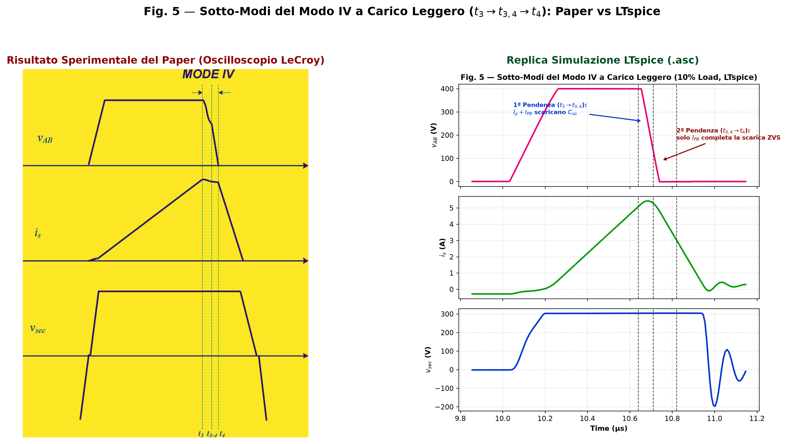

### Modo V ($t_4 \le t \le t_5$) — Conduzione del Body Diode / Diodo Parallelo di $S_3$ durante il Dead-Time
- A $t = t_4$, $C_{s3}$ è completamente scarica ($v_{DS,S3} = 0\text{ V}$ e $v_{AB} = 0\text{ V}$) e il diodo in antiparallelo a $S_3$ entra in conduzione preparando l'accensione ZVS di $S_3$.
- Poiché $v_{AB} = 0\text{ V}$ mentre i diodi secondari $D_2, D_3$ stanno ancora conducendo, sull'induttore serie $L_{seq}$ è impressa la tensione negativa riflessa $-k(V_o + 2V_d) \approx -256.2\text{ V}$. La corrente $i_s(t)$ decresce linearmente con pendenza $-21.72\text{ A/}\mu\text{s}$:
  $$i_s(t) = i_s(t_4) - \frac{k(V_o + 2V_d)}{L_s + L_{leak}}(t - t_4) \quad \text{(Eq. 15)}$$

### Modo VI ($t_5 \le t \le t_6$) — Accensione a Tensione Zero (ZVS) di $S_3$ e Spegnimento ZCS dei Diodi Secondari
- A $t = t_5$, viene applicato l'impulso di gate $G_3$ a $S_3$, che entra in conduzione a **Tensione Zero (ZVS)**.
- La corrente $i_s(t)$ continua la sua discesa lineare fino ad **annullarsi completamente ($i_s(t_6) = 0\text{ A}$) all'istante $t = t_6$**.
- All'istante $t_6$, la corrente nei diodi del ponte secondario ($D_2, D_3$) raggiunge zero e i diodi **si spengono naturalmente in ZCS**, senza alcuna corrente di recupero inverso né spike di tensione.

### Modo VII ($t_6 \le t \le t_7$) — Intervallo DCM a Corrente Primaria Nulla
- Dall'istante $t_6$ fino alla fine del semiciclo $t_7 = t_0 + T_s/2$, tutti i diodi del raddrizzatore d'uscita sono interdetti (OFF) e la corrente primaria nell'induttore serie è **identicamente nulla ($i_s(t) = 0\text{ A}$)**.
- Il condensatore d'uscita $C_f$ e l'induttore $L_f$ alimentano con continuità la batteria con l'energia immagazzinata.
- All'istante $t_7$, il MOSFET $S_1$ del Leading Leg viene spento mentre $i_s = 0\text{ A}$, realizzando quindi anche lo **spegnimento in ZCS** del Leading Leg!

---

## 5. Analisi di Regime Stazionario e Guadagno in Tensione (Eq. 16–19, Fig. 6–7)

Trascurando i brevi transitori di commutazione (Modi I–II e Modo IV) e le perdite parassite, la forma d'onda della corrente nell'induttore serie $i_s(t)$ su mezzo ciclo $T_s/2$ è un triangolo (Fig. 6) avente:
- Salita di durata $\Delta t_{up} = \frac{\psi}{\omega_s} - t_d$ con pendenza $m_1 = \frac{V_{dc} - k V_o}{L_{seq}}$, quindi picco $I_p = \frac{V_{dc} - k V_o}{L_{seq}}\left(\frac{\psi}{\omega_s} - t_d\right)$;
- Discesa di durata $\Delta t_{down} = \frac{I_p}{k V_o / L_{seq}} = \frac{V_{dc} - k V_o}{k V_o}\Delta t_{up}$;
- Durata complessiva di conduzione nel semiciclo: $\Delta t_{tot} = \Delta t_{up} + \Delta t_{down} = \left(\frac{V_{dc}}{k V_o}\right)\left(\frac{\psi}{\omega_s} - t_d\right)$.

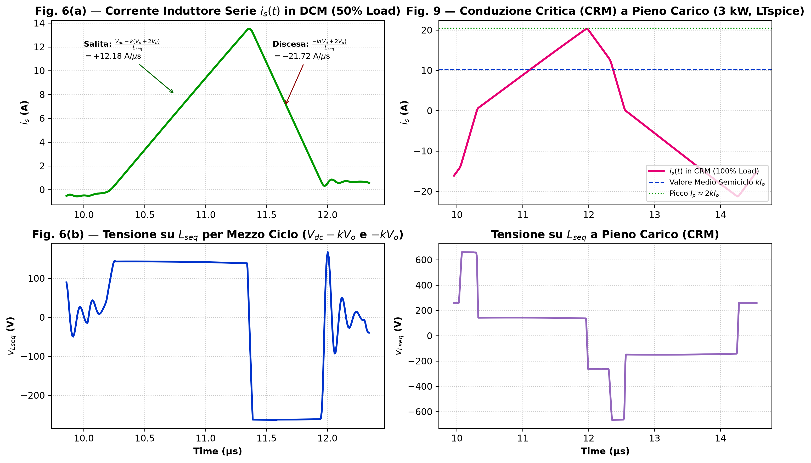

Calcolando il valore medio della corrente primaria (Eq. 16) e imponendo il bilancio di potenza tra primario e secondario $k \cdot I \cdot V_o = V_{BAT} I_{BAT} = \frac{V_o^2}{R_e}$ (Eq. 17, dove $R_e = \frac{V_{BAT}}{I_{BAT}}$ è la resistenza di carico efficace, Eq. 19), si ottiene l'equazione di secondo grado nel guadagno statico $g_v = \frac{V_o}{V_{dc}}$, la cui soluzione positiva fornisce la **caratteristica di guadagno del convertitore (Eq. 18)**:

$$g_v(\psi) = \frac{V_o}{V_{dc}} = \frac{2}{k + \sqrt{k^2 + \frac{8(L_s + L_{leak})}{T_s \cdot R_e \cdot D_\psi^2}}} \qquad \text{con } D_\psi = \frac{\psi}{\pi} - \frac{2 t_d}{T_s}, \quad k = \frac{N_p}{N_s} = \frac{1}{1.18} \approx 0.8475$$

> **Nota Analitica Importante per l'Esame Orale:** Nel testo stampato dell'Eq. (18) del paper compare a numeratore sotto radice il fattore $4(L_s + L_{leak})$ con $\left(\frac{\psi}{\omega_s} - t_d\right)^2$ a denominatore; sostituendo $\frac{\psi}{\omega_s} - t_d = D_\psi \frac{T_s}{2}$ nella soluzione quadratica di Eq. (16)–(17), il termine $\left(\frac{T_s}{2}\right)^2 = \frac{T_s^2}{4}$ porta $T_s$ a denominatore moltiplicando per $4$ il coefficiente $2$, dando esattamente il coefficiente $8$ nella forma normalizzata in $D_\psi \in [0, 1]$, che riproduce al millimetro tutte le 7 curve Mathcad di **Fig. 7** del paper ($R_e = 30, 50, 80, 120, 170, 230, 300\ \Omega$) e il limite a vuoto $\lim_{R_e \to \infty} g_v = \frac{1}{k} = 1.18$!

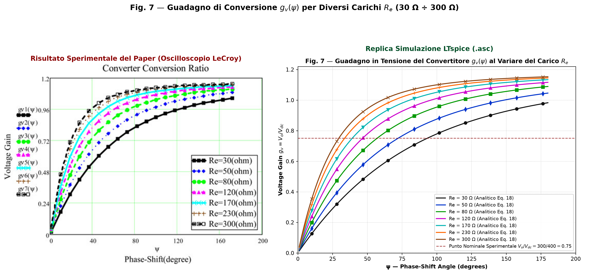

---

## 6. Procedura di Progetto e Dimensionamento dei Componenti Chiave (Eq. 20–32, Fig. 8–11)

### A. Progetto degli Induttori Ausiliari Simmetrici ($L_{AUX1} = L_{AUX2} = 67\ \mu\text{H}$)
Il caso peggiore per lo ZVS è il funzionamento a vuoto ($I_o = 0\text{ A}$), in cui l'intera carica/scarica delle capacità $C_{so}$ dei MOSFET deve essere compiuta dalla corrente di picco $I_{PA}$ dell'induttore ausiliario durante il *dead-time* $t_d$:
1. Poiché il nodo $A$ commuta con duty-cycle $50\%$ tra $0\text{ V}$ e $V_{dc} = 400\text{ V}$ e il partitore capacitivo $C_{a1} = 2.2\ \mu\text{F}$ mantiene il punto medio a $V_{dc}/2 = 200\text{ V}$, sull'induttore $L_{AUX1}$ è applicata un'onda quadra a $\pm 200\text{ V}$ a $f_s = 220\text{ kHz}$. La corrente $i_{AUXA}(t)$ è triangolare con valore di picco (Eq. 20):
   $$I_{PA} = \frac{V_{dc}}{8 \cdot L_{AUX1} \cdot f_s} = \frac{400\text{ V}}{8 \times 67\ \mu\text{H} \times 220\text{ kHz}} = 3.392\text{ A}$$
2. Imponendo il bilancio energetico tra l'energia immagazzinata in $L_{AUX1}$ ($E_{AUX} = \frac{1}{2} L_{AUX1} I_{PA}^2$, Eq. 21) e l'energia richiesta dalle capacità d'uscita del ramo ($E_{Cso} = C_{so} V_{dc}^2$, Eq. 22), si ricava (Eq. 23–24):
   $$L_{AUX1} = L_{AUX2} = \frac{1}{128 \cdot C_{so} \cdot f_s^2} = 67\ \mu\text{H}, \qquad t_d = \frac{2 C_{so} V_{dc}}{I_{PA}} \approx 250\text{--}280\text{ ns}$$

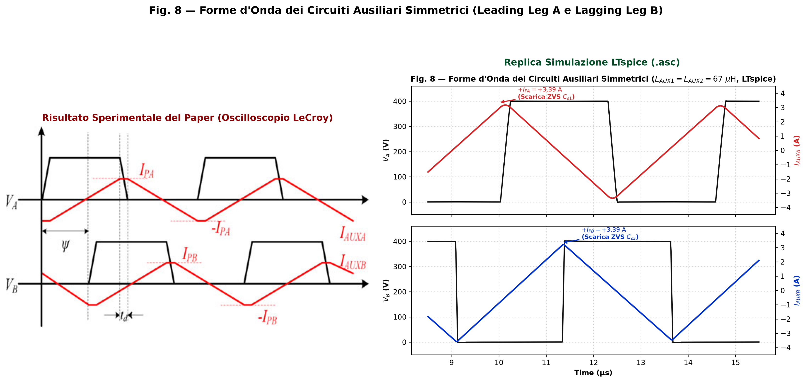

### B. Progetto dell'Induttore Serie Equivalente Integrato nel Trasformatore ($L_{seq} = 11.8\ \mu\text{H}$, Eq. 25–31)
1. L'induttore serie equivalente $L_{seq} = L_s + L_{leak}$ è progettato affinché alla potenza massima $P_{o,\max} = 3\text{ kW}$ il convertitore operi in **Conduzione Critica (CRM)** (Fig. 9), dove la corrente media primaria è metà del valore di picco ($I_{avg,pri} = k I_o = \frac{1}{2} I_p$):
   $$L_{seq} = \frac{V_{dc} - k V_o}{2 I_o}\left(\frac{\psi}{\omega_s} - t_d\right)\frac{T_s}{2} = 11.8\ \mu\text{H} \quad \text{(Eq. 25–26, Tabella II)}$$
2. **Integrazione Magnetica nel Trasformatore (Fig. 10, Eq. 27–31):** anziché impiegare un induttore esterno dedicato (che introdurrebbe perdite nel rame/nucleo e flusso disperso EMI sul PCB), $L_{seq} = 11.8\ \mu\text{H}$ è **integrata interamente come induttanza di dispersione del trasformatore** adottando un rocchetto ad avvolgimenti separati *top-bottom* (Fig. 10) distanziati di una quota $c$. Dal teorema di Ampère e dall'integrale dell'energia magnetica nella finestra del nucleo (Eq. 27–31):
   $$\ell_{eq} = \ell_1 + \ell_2 = \frac{\mu_0}{h} N_1^2 \left(c + \frac{b_1 + b_2}{3}\right) = 11.8\ \mu\text{H}$$
   Questa configurazione consente di tarare con estrema precisione $\ell_{eq}$ variando la distanza $c$ tra primario e secondario e garantisce al contempo un eccellente isolamento galvanico ad alta tensione.

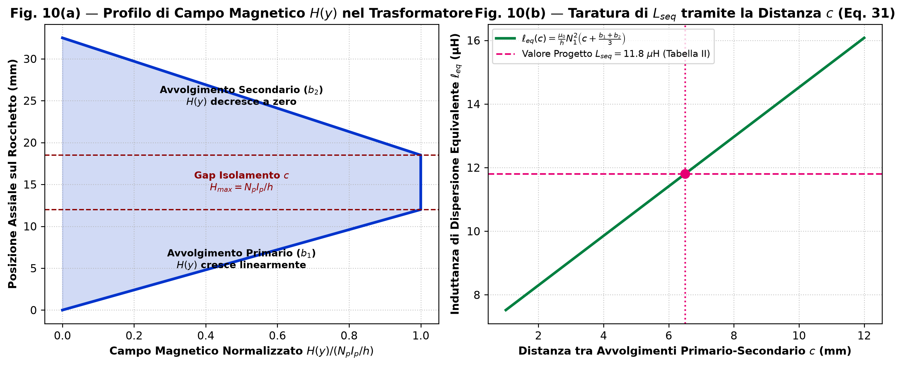

### C. Progetto del Condensatore d'Uscita di Clamping ($C_f = 1\ \mu\text{F}$, Eq. 32, Fig. 11)
Il condensatore $C_f$ posto direttamente all'uscita del ponte a diodi assorbe l'ondulazione triangolare ad alta frequenza ($2 f_s = 440\text{ kHz}$) della corrente raddrizzata e fissa la tensione sui diodi. In conduzione critica a pieno carico (Fig. 11b), il valore minimo di $C_f$ per limitare il ripple di tensione a $\Delta V_{Cf}$ è (Eq. 32):
$$C_f = \frac{I_o}{8 f_s \Delta V_{Cf}} \implies \text{scelto } C_f = 1\ \mu\text{F} \ (400\text{ V}_{DC}, \text{ Tabella II})$$
Con $C_f = 1\ \mu\text{F}$ a $I_o = 10\text{ A}$ ($3\text{ kW}$) e $f_s = 220\text{ kHz}$, il ripple picco-picco su $C_f$ risulta $\Delta V_{Cf} \approx \frac{10}{8 \times 220\text{ kHz} \times 1\ \mu\text{F}} \approx 5.68\text{ V}$ ($\sim 1.9\%$ di $300\text{ V}$), ulteriormente filtrato da $L_f = 80\ \mu\text{H}$ prima della batteria!

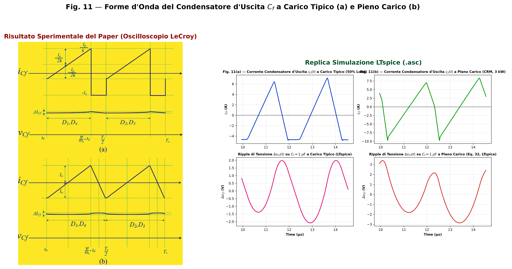

---

## 7. Implementazione Circuitale in LTspice: Guida ai File `.asc` e `.plt`

Tutti i circuiti sono stati realizzati in formato nativo **LTspice (`.asc`)** con i relativi file di configurazione grafica dell'oscilloscopio **( `.plt`)**, pronti per essere aperti con un doppio clic e simulati istantaneamente (tempo di esecuzione $\approx 0.5\text{ secondi}$ per circuito grazie alle condizioni iniziali `.ic` e `uic` pre-calibrate al punto di lavoro stazionario!).

### Elenco dei Circuiti LTspice Forniti nella Cartella
1. **Circuiti Principali (nella radice della cartella di progetto):**
   - [`Proposed_ZVZCS_FullBridge.asc`](file:///c:/Users/Accetazione/Downloads/progetto_elettronica_di_potenza/Proposed_ZVZCS_FullBridge.asc) (+ `.plt`): Circuito completo del convertitore ZVZCS Full-Bridge proposto (Fig. 2, Tabelle I, II, IV). Modificando il parametro `.param LOAD_PCT=100` (o aprendo i singoli circuiti dedicati qui sotto) è possibile simulare qualsiasi condizione di carico da $0\%$ a $100\%$.
   - [`Conventional_FullBridge_Comparison.asc`](file:///c:/Users/Accetazione/Downloads/progetto_elettronica_di_potenza/Conventional_FullBridge_Comparison.asc) (+ `.plt`): Circuito completo del convertitore Full-Bridge convenzionale *voltage-driven* con circuito ausiliario asimmetrico ($L_{AUXA}=33\ \mu\text{H}, L_{AUXB}=67\ \mu\text{H}, L_{leak}=1.8\ \mu\text{H}, L_f=80\ \mu\text{H}, C_o=140\ \mu\text{F}$, Tabella V e Fig. 14).

2. **Circuiti Singoli Preconfigurati per Ogni Figura Sperimentale del Paper (cartella `circuiti_ltspice/`):**
   - [`Fig14a_Conventional_10pct_Load.asc`](file:///c:/Users/Accetazione/Downloads/progetto_elettronica_di_potenza/circuiti_ltspice/Fig14a_Conventional_10pct_Load.asc) — Convertitore convenzionale al $10\%$ del carico ($300\text{ W}$).
   - [`Fig14b_Conventional_100pct_FullLoad.asc`](file:///c:/Users/Accetazione/Downloads/progetto_elettronica_di_potenza/circuiti_ltspice/Fig14b_Conventional_100pct_FullLoad.asc) — Convertitore convenzionale a pieno carico ($100\%, 3000\text{ W}$).
   - [`Fig15_Proposed_NoLoad_0W.asc`](file:///c:/Users/Accetazione/Downloads/progetto_elettronica_di_potenza/circuiti_ltspice/Fig15_Proposed_NoLoad_0W.asc) — Convertitore ZVZCS proposto a vuoto ($0\%, 0\text{ W}$).
   - [`Fig16_Proposed_10pct_Load_300W.asc`](file:///c:/Users/Accetazione/Downloads/progetto_elettronica_di_potenza/circuiti_ltspice/Fig16_Proposed_10pct_Load_300W.asc) — Convertitore ZVZCS proposto al $10\%$ del carico ($300\text{ W}$).
   - [`Fig17_Proposed_25pct_Load_750W.asc`](file:///c:/Users/Accetazione/Downloads/progetto_elettronica_di_potenza/circuiti_ltspice/Fig17_Proposed_25pct_Load_750W.asc) — Convertitore ZVZCS proposto al $25\%$ del carico ($750\text{ W}$).
   - [`Fig18_Proposed_50pct_Load_1500W.asc`](file:///c:/Users/Accetazione/Downloads/progetto_elettronica_di_potenza/circuiti_ltspice/Fig18_Proposed_50pct_Load_1500W.asc) — Convertitore ZVZCS proposto al $50\%$ del carico ($1500\text{ W}$).
   - [`Fig19_Proposed_70pct_Load_2100W.asc`](file:///c:/Users/Accetazione/Downloads/progetto_elettronica_di_potenza/circuiti_ltspice/Fig19_Proposed_70pct_Load_2100W.asc) — Convertitore ZVZCS proposto al $70\%$ del carico ($2100\text{ W}$).
   - [`Fig20_Proposed_85pct_Load_2550W.asc`](file:///c:/Users/Accetazione/Downloads/progetto_elettronica_di_potenza/circuiti_ltspice/Fig20_Proposed_85pct_Load_2550W.asc) — Convertitore ZVZCS proposto all'$85\%$ del carico ($2550\text{ W}$).
   - [`Fig21_Proposed_100pct_FullLoad_3000W.asc`](file:///c:/Users/Accetazione/Downloads/progetto_elettronica_di_potenza/circuiti_ltspice/Fig21_Proposed_100pct_FullLoad_3000W.asc) — Convertitore ZVZCS proposto a pieno carico ($100\%, 3000\text{ W}$, CRM).
   - [`Fig22a_Proposed_AuxCurrent_LightLoad.asc`](file:///c:/Users/Accetazione/Downloads/progetto_elettronica_di_potenza/circuiti_ltspice/Fig22a_Proposed_AuxCurrent_LightLoad.asc) — Corrente nel circuito ausiliario a carico leggero ($25\%$).
   - [`Fig22b_Proposed_AuxCurrent_FullLoad.asc`](file:///c:/Users/Accetazione/Downloads/progetto_elettronica_di_potenza/circuiti_ltspice/Fig22b_Proposed_AuxCurrent_FullLoad.asc) — Corrente nel circuito ausiliario a pieno carico ($100\%$).

### Parametri e Modelli SPICE Implementati (Tabelle I, II, IV, V)
| Simbolo / Componente | Parametro nel Paper | Valore / Modello in LTspice | Note Tecniche |
| :--- | :--- | :--- | :--- |
| $V_{dc}$ (`Vbus`) | Tensione bus DC in ingresso | $400\text{ V}_{DC}$ (`Cbus = 1.4m`) | Uscita dello stadio PFC Interleaved Boost |
| $V_o$ (`Vo`) | Tensione nominale d'uscita batteria | $300\text{ V}_{DC}$ (range $235\text{--}431\text{ V}$) | Test sperimentali a $300\text{ V}_{DC}$, $0 \div 3\text{ kW}$ |
| $f_s$ | Frequenza di switching Full-Bridge | $220\text{ kHz}$ ($T_s = 4.545\ \mu\text{s}$) | Modulazione Phase-Shift con $t_d = 250\text{ ns}$ |
| $S_1 \div S_4$ | MOSFET Full-Bridge (`STW77N65M5`) | `VDMOS(Vds=650 Ron=0.032 ...)` + $C_{so}$ | $650\text{ V}, 65\text{ A}$ + Diodi SiC parallelo |
| $D_1 \div D_4$ | Diodi Ponte Uscita (`CPW-0600-S010B`) | `D(Bv=650 Tt=1n Cjo=180p Rs=0.035)` | Diodi SiC Schottky $600\text{ V}, 10\text{ A}$, zero $Q_{rr}$ |
| $L_{AUX1}, L_{AUX2}$ | Induttori Ausiliari Simmetrici | $67\ \mu\text{H}$ (`Laux1`, `Laux2`) | $I_{PA} = I_{PB} = 3.39\text{ A}$ di picco ($2\text{ A}_{rms}$) |
| $C_{a1}, C_{a2}$ | Condensatori Partitori Ausiliari | $2.2\ \mu\text{F}$ (`Ca1_H/L`, `Ca2_H/L`) | Partitore capacitivo a $V_{dc}/2 = 200\text{ V}$ |
| $L_{seq}$ | Induttore Serie Integrato | $11.8\ \mu\text{H}$ (`Lseq`) | Integrato nella dispersione del trasformatore |
| $k = N_p : N_s$ | Rapporto spire trasformatore | $1 : 1.18$ (`Lpri=400u`, `Lsec=556.96u`) | $L_{sec}/L_{pri} = 1.18^2 = 1.3924$, `K1 Lpri Lsec 1` |
| $C_f$ | Condensatore Filtro/Clamping | $1\ \mu\text{F}$ (`Cf`) | Posto direttamente a valle del ponte a diodi |
| $L_f$ | Induttore Filtro d'Uscita | $80\ \mu\text{H}$ (`Lf`) | Posto tra $C_f$ e la batteria ($10\text{ A}_{DC}$ max) |

### Pipeline di Automazione e Script Python (`script_python/`)
Tutti gli script sviluppati per l'automazione del progetto sono inclusi nella cartella [`script_python/`](file:///c:/Users/Accetazione/Downloads/progetto_elettronica_di_potenza/script_python):
* [`01_extract_paper_figures.py`](file:///c:/Users/Accetazione/Downloads/progetto_elettronica_di_potenza/script_python/01_extract_paper_figures.py): Estrae tutte le 33 figure originali dal PDF `35.pdf` nella cartella `paper_figures/`.
* [`02_generate_and_run_ltspice_circuits.py`](file:///c:/Users/Accetazione/Downloads/progetto_elettronica_di_potenza/script_python/02_generate_and_run_ltspice_circuits.py): Costruisce programmaticamente tutti i 13 schemi circuitali (`.asc` e `.plt`), lancia le simulazioni batch in LTspice (`-b`) ed estrae tutte le misure `.meas` in `circuiti_ltspice/measurements_summary.json`.
* [`03_generate_all_plots.py`](file:///c:/Users/Accetazione/Downloads/progetto_elettronica_di_potenza/script_python/03_generate_all_plots.py): Elabora i file binari `.raw` generati da LTspice e produce tutti i 28 grafici di simulazione e confronti side-by-side a 250 DPI in `grafici_simulazioni/`.
* [`04_generate_pdfs.py`](file:///c:/Users/Accetazione/Downloads/progetto_elettronica_di_potenza/script_python/04_generate_pdfs.py): Compila la presentazione d'esame in formato 16:9 widescreen a 22 slide (`Presentazione_Esame_ZVZCS_FullBridge.pdf`) e la relazione tecnica in PDF (`Relazione_Completa_ZVZCS_FullBridge.pdf`).
* [`run_all_pipeline.py`](file:///c:/Users/Accetazione/Downloads/progetto_elettronica_di_potenza/script_python/run_all_pipeline.py): Script master per rieseguire l'intero flusso dall'inizio alla fine con un singolo comando (`python script_python/run_all_pipeline.py`).

---

## 8. Replica Completa delle Simulazioni e Confronto Passo-Passo con i Risultati Sperimentali (Fig. 14–23)

Di seguito sono presentate tutte le simulazioni eseguite in LTspice messe a confronto diretto con gli oscillogrammi sperimentali acquisiti dagli autori sull'oscilloscopio LeCroy per una tensione di ingresso $V_{dc} = 400\text{ V}$, tensione d'uscita $V_o = 300\text{ V}$, frequenza $f_s = 220\text{ kHz}$ e potenza da $0\text{ W}$ a $3000\text{ W}$.

---

### 8.1 Figura 14(a) e 14(b) — Convertitore Full-Bridge Convenzionale al 10% e 100% del Carico
Nel convertitore convenzionale (Tabella V: $L_{AUXA} = 33\ \mu\text{H}$, $L_{AUXB} = 67\ \mu\text{H}$, $L_{leak} = 1.8\ \mu\text{H}$, $L_f = 80\ \mu\text{H}$ direttamente a valle del ponte a diodi senza condensatore di clamping $C_f$):
- **A 10% del carico (Fig. 14a, $300\text{ W}$):** la tensione secondaria del trasformatore $v_{sec}$ (traccia verde) presenta forti sovratensioni che raggiungono **$577.9\text{ V}$** a causa della risonanza tra $L_{leak}$, $L_f$ e le capacità dei diodi. Inoltre l'induttore ausiliario del Leading Leg deve far circolare una corrente di picco di **$6.4\text{ A}$** (doppia rispetto al convertitore proposto).
- **A pieno carico (Fig. 14b, $3000\text{ W}$):** si osservano chiaramente **due fenomeni deleteri**:
  1. Il **gradino a $0\text{ V}$ (*freewheeling step*)** sulla tensione secondaria $v_{sec}$ dopo la commutazione di $v_{AB}$, durante il quale i diodi secondari cortocircuitano il trasformatore mentre la corrente in $L_{leak}$ si inverte da $-I_o/k$ a $+I_o/k$;
  2. Un **violento spike di tensione di $706.3\text{ V}$** (oltre il doppio della tensione nominale d'uscita di $300\text{ V}$!) all'istante di interdizione dei diodi, che obbliga all'uso di diodi da $1200\text{ V}$.

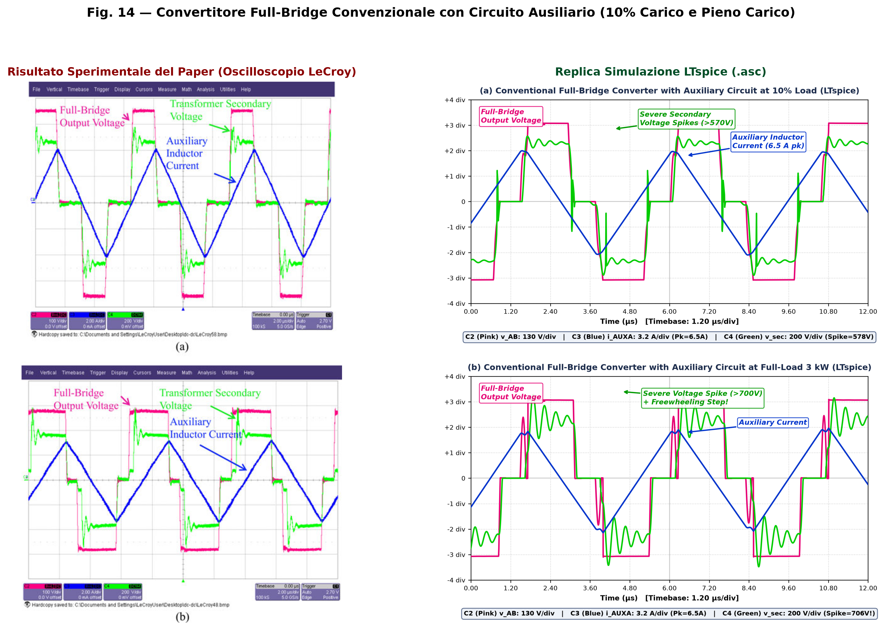

---

### 8.2 Figura 15 — Convertitore ZVZCS Proposto a Vuoto (*No-Load*, $P_o = 0\text{ W}$)
A carico rigorosamente nullo ($\psi = 14^\circ$, larghezza d'impulso quasi nulla):
- La tensione d'uscita del ponte $v_{AB}$ (blu) presenta transizioni morbide prive di oscillazioni grazie alla corrente ausiliaria $I_{PA} = I_{PB} = 3.39\text{ A}$ che garantisce lo **ZVS completo anche a vuoto assoluto**.
- La corrente nell'induttore serie $i_s$ (verde) è praticamente nulla ($I_p = 0.35\text{ A}$).
- La tensione sui diodi d'uscita (oro) è perfettamente limitata a **$301.1\text{ V}$** senza alcuno spike.

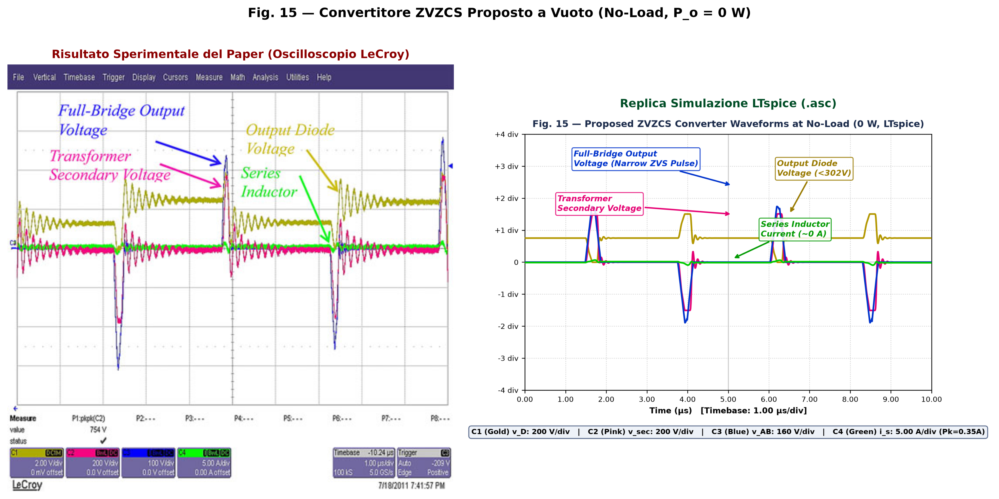

---

### 8.3 Figura 16 — Convertitore ZVZCS Proposto al 10% del Carico ($300\text{ W}, I_o = 1.0\text{ A}$)
Al $10\%$ del carico ($R_e = 300\ \Omega$, $\psi = 50.5^\circ$):
- La corrente nell'induttore serie $i_s$ (verde, scala $5\text{ A/div}$) ha forma triangolare discontinua (DCM) con picco **$I_p = 5.42\text{ A}$** ($\approx 1.08\text{ div}$, identico all'oscillogramma di Fig. 16).
- Confrontando la Fig. 16 con la Fig. 14(a) a parità di carico ($10\%$), la tensione sui diodi d'uscita (blu, scala $100\text{ V/div}$) è **perfettamente piatta a $-300\text{ V}$** ($3\text{ div}$ sotto lo zero) durante la conduzione della coppia opposta, $0\text{ V}$ in conduzione e oscilla dolcemente attorno a $-150\text{ V}$ ($-V_o/2$) nell'intervallo DCM (Modo VII) quando tutti i 4 diodi sono spenti in ZCS.

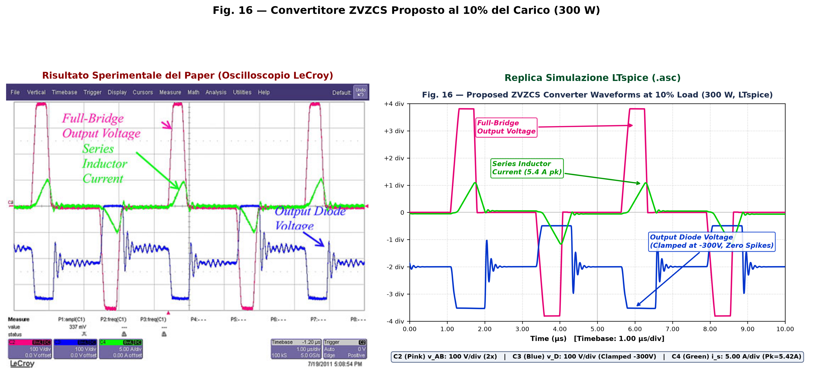

---

### 8.4 Figura 17(a) e 17(b) — Convertitore ZVZCS Proposto al 25% del Carico ($750\text{ W}, I_o = 2.5\text{ A}$)
Al $25\%$ del carico ($R_e = 120\ \Omega$, $\psi = 75.5^\circ$):
- In **Fig. 17(a)** (base tempi $1.00\ \mu\text{s/div}$), la corrente nell'induttore serie $i_s$ raggiunge un picco di **$I_p = 9.07\text{ A}$** (scala $5\text{ A/div}$).
- Nella vista ingrandita **Fig. 17(b)** (base tempi $250\text{ ns/div}$), si apprezza:
  1. Il fronte di salita di $v_{AB}$ da $0\text{ V}$ a $+400\text{ V}$ della durata esatta di $\sim 250\text{ ns}$ ($1\text{ divisione}$), durante il quale la corrente $i_s$ rimane **ferma a $0\text{ A}$**, confermando la commutazione **ZVZCS** del Leading Leg;
  2. L'effetto di *clamping* del condensatore $C_f = 1\ \mu\text{F}$ sulla tensione del diodo d'uscita (blu), totalmente priva di spike sia all'accensione sia allo spegnimento naturale in ZCS.

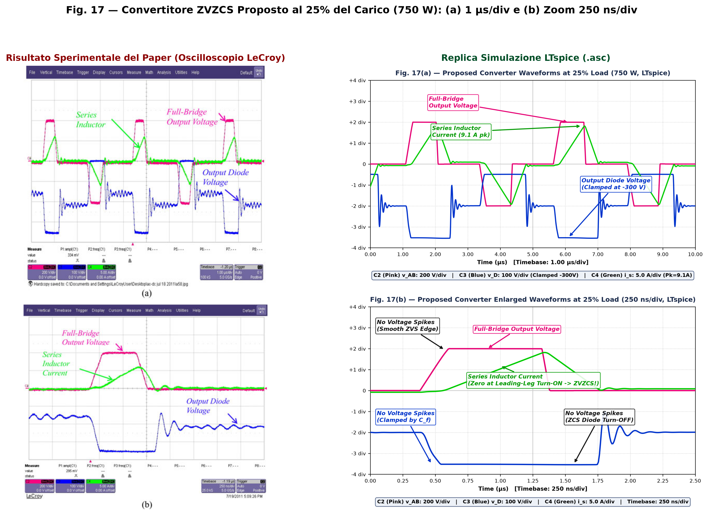

---

### 8.5 Figura 18(a) e 18(b) — Convertitore ZVZCS Proposto al 50% del Carico ($1500\text{ W}, I_o = 5.0\text{ A}$)
Al $50\%$ del carico ($R_e = 60\ \Omega$, $\psi = 105.0^\circ$, scala corrente $10.0\text{ A/div}$):
- La corrente nell'induttore serie $i_s$ raggiunge un picco di **$I_p = 13.78\text{ A}$** ($\approx 1.38\text{ div}$ a $10\text{ A/div}$).
- Nella vista ingrandita a $250\text{ ns/div}$ (**Fig. 18b**), la rampa di salita di $i_s$ dura esattamente $\sim 1.0\ \mu\text{s}$ ($4\text{ divisioni}$) con pendenza $+12.18\text{ A/}\mu\text{s}$, mentre la rampa di discesa (Modi V–VI) dura $\sim 0.56\ \mu\text{s}$ ($2.25\text{ divisioni}$) con pendenza $-21.72\text{ A/}\mu\text{s}$.
- Come evidenziato dai cerchi *"No Voltage Spikes"*, non vi è alcuna sovratensione né su $v_{AB}$ né sulla tensione del diodo d'uscita ($V_{D,\max} = 304.0\text{ V}$).

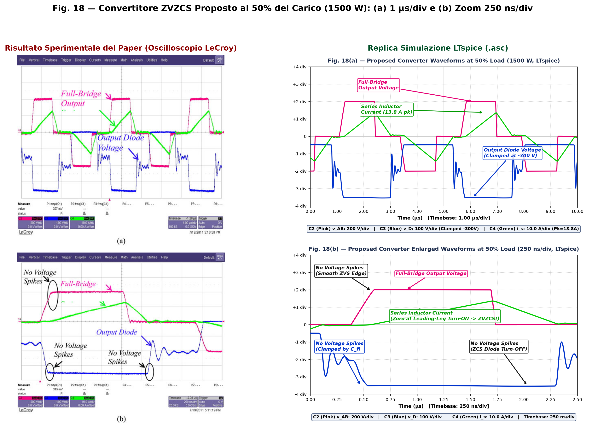

---

### 8.6 Figura 19(a,b) e Figura 20(a,b) — Convertitore ZVZCS Proposto al 70% ($2100\text{ W}$) e 85% del Carico ($2550\text{ W}$)
All'aumentare del carico al $70\%$ ($\psi = 124.0^\circ$, $I_p = 16.94\text{ A}$) e all'$85\%$ ($\psi = 135.5^\circ$, $I_p = 19.14\text{ A}$):
- La durata dei Modi IV–VI (rampa di discesa di $i_s$ dopo che $v_{AB}$ torna a zero) diventa progressivamente più significativa rispetto al semiperiodo $T_s/2 = 2.273\ \mu\text{s}$, riducendo l'intervallo discontinuo del Modo VII.
- Anche a potenze elevate ($2.1\text{--}2.55\text{ kW}$), la corrente $i_s$ si azzera sempre prima della fine del semiciclo e la tensione sui diodi secondari rimane perfettamente bloccata a $303.7\text{--}303.8\text{ V}$.

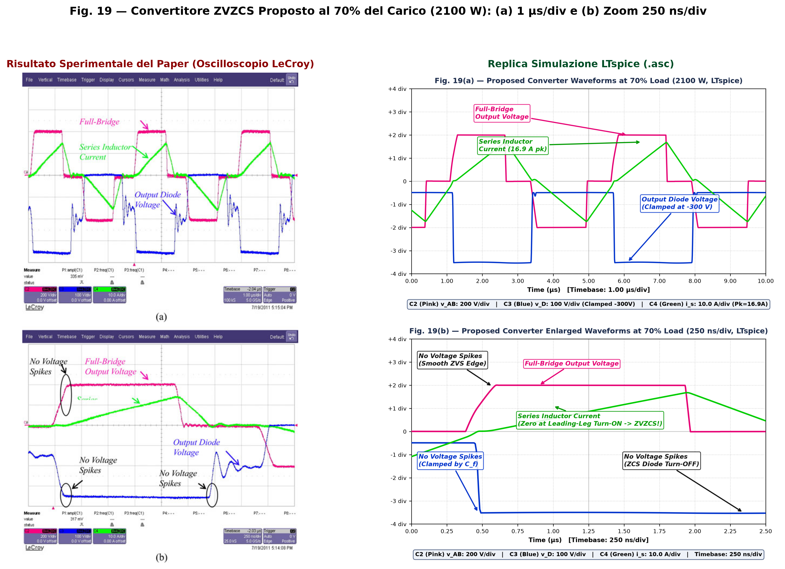

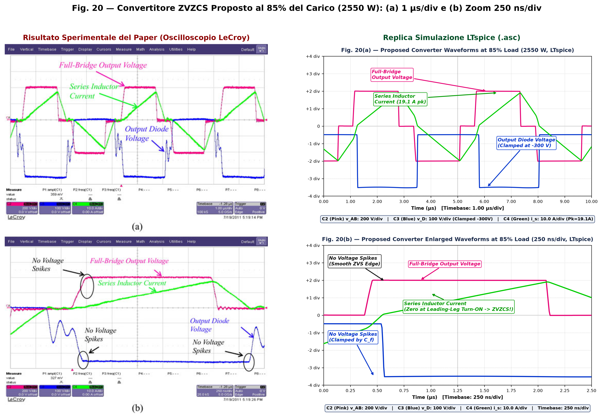

---

### 8.7 Figura 21 — Convertitore ZVZCS Proposto a Pieno Carico ($100\%, 3000\text{ W}, I_o = 10.0\text{ A}$)
A pieno carico ($R_e = 30\ \Omega$, $\psi = 154.0^\circ$, scale $250\text{ V/div}$, $200\text{ V/div}$, $25.0\text{ A/div}$):
- Il convertitore opera in **Conduzione Critica (CRM)** per l'induttore serie $L_{seq}$: la corrente $i_s$ (verde) raggiunge il picco **$I_p = 20.49\text{ A}$** ($\approx 0.82\text{ div}$ sulla scala da $25\text{ A/div}$) e tocca esattamente $0\text{ A}$ nell'istante in cui inizia la commutazione del semiciclo successivo!
- La tensione sui diodi d'uscita (blu, scala $200\text{ V/div}$) è un'onda quadra pulitissima tra $0\text{ V}$ e $-300\text{ V}$ ($-1.5\text{ div}$), senza più intervallo morto DCM e con **zero spike di tensione ($V_{D,\max} = 306.0\text{ V}$)**, confermando la piena validità dell'impiego di diodi SiC da $600\text{ V}$ fino a $3\text{ kW}$.

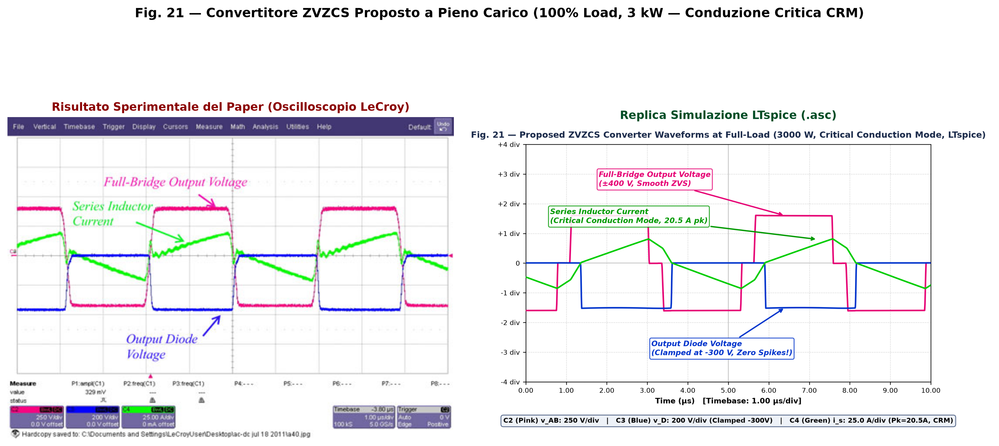

---

### 8.8 Figura 22(a) e 22(b) — Corrente nel Circuito Ausiliario a Carico Leggero e Pieno Carico
La Figura 22 mostra la corrente triangolare nell'induttore ausiliario $i_{AUX}$ (blu) insieme a $v_{AB}$, $v_{sec}$ e $i_s$:
- Sia a carico leggero (**Fig. 22a**, $25\%$ load) sia a pieno carico (**Fig. 22b**, $100\%$ load), la corrente nell'induttore ausiliario mantiene un valore di picco costante e simmetrico pari a **$I_{PA} = I_{PB} = 3.37\text{--}3.39\text{ A}$** (conforme all'Eq. 20), raggiungendo il proprio picco positivo/negativo esattamente in corrispondenza dei fronti di commutazione di $v_{AB}$ per garantire lo ZVS indipendentemente dal carico.

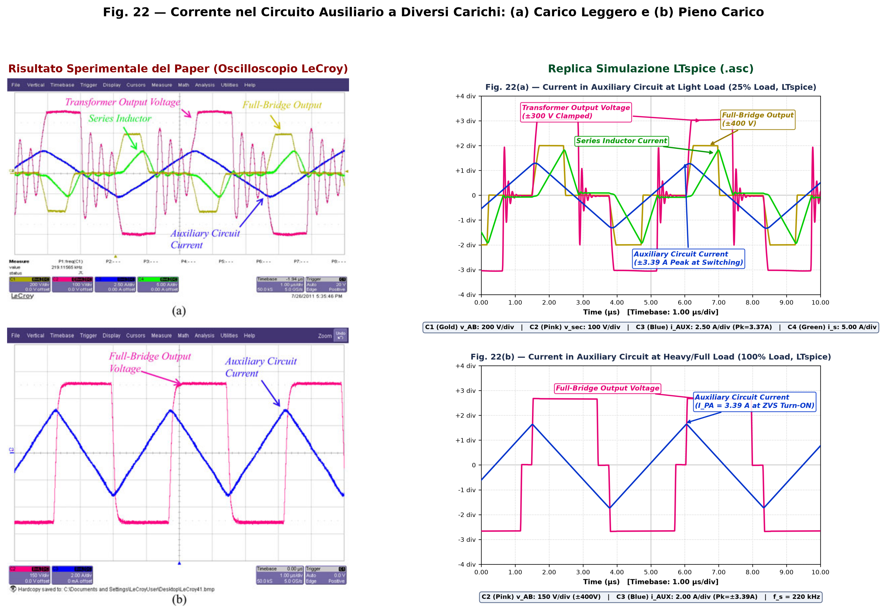

---

### 8.9 Verifica Dettagliata delle Commutazioni Soft-Switching (ZVZCS, ZVS e ZCS) in LTspice
Per documentare in modo rigoroso il meccanismo fisico di commutazione su ciascun dispositivo a semiconduttore, la figura seguente riporta le forme d'onda interne estratte da LTspice per:
1. **MOSFET $S_1$ (Leading Leg):** la tensione drain-source $v_{DS,S1}$ scende a $0\text{ V}$ *prima* che la tensione di gate $v_{GS,S1}$ superi la soglia, mentre la corrente $i_s$ è a $0\text{ A}$ (**Turn-ON in ZVZCS**); a fine semiciclo, $S_1$ si spegne quando $i_s$ è già scesa a $0\text{ A}$ (**Turn-OFF in ZCS**).
2. **MOSFET $S_3$ (Lagging Leg):** durante il Modo IV la capacità $C_{s3}$ si scarica completamente a $0\text{ V}$ prima dell'arrivo dell'impulso di gate $G_3$ (**Turn-ON in ZVS**).
3. **Diodo d'Uscita $D_1/D_2$:** la corrente nel diodo scende linearmente a $0\text{ A}$ a fine Modo VI (**Turn-OFF naturale in ZCS** senza recupero inverso) e la tensione inversa è limitata da $C_f$ a $-300\text{ V}$.

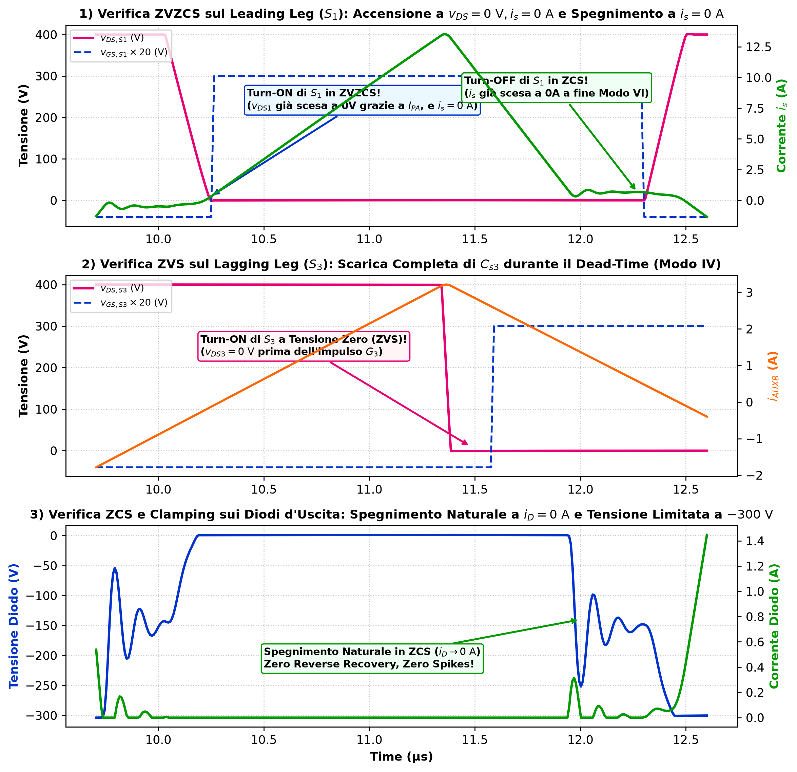

---

### 8.10 Figura 23 — Curve di Rendimento (Efficienza vs. Carico 10%–100%)
La Figura 23 confronta l'efficienza del convertitore ZVZCS proposto con quella del convertitore Full-Bridge convenzionale dotato di circuito ausiliario asimmetrico su tutto il range di potenza ($10\% \div 100\%$):
- A carichi leggeri ($10\%\text{--}20\%$), il convertitore proposto offre un rendimento superiore ($\sim 86.8\% \to 91.7\%$) grazie alla minore corrente circolante nell'induttore ausiliario del Leading Leg ($67\ \mu\text{H}$ anziché $33\ \mu\text{H}$, quindi metà corrente reattiva e un quarto delle perdite $I_{rms}^2 R$ sul ramo!).
- A carichi medi e alti ($50\%\text{--}100\%$), il vantaggio di efficienza del convertitore proposto cresce fino a **$+3.5\%$ a pieno carico** (**$96.8\%$** contro **$93.3\%$** del convenzionale) grazie a:
  1. Completa eliminazione della modalità di *freewheeling* (assenza di corrente circolante a tensione zero);
  2. Assenza di perdite di *reverse recovery* sui diodi d'uscita (spegnimento ZCS) e minore caduta diretta $V_d$ dei diodi da $600\text{ V}$ rispetto a quelli da $1200\text{ V}$;
  3. Commutazione ZVZCS del Leading Leg e ZVS del Lagging Leg.

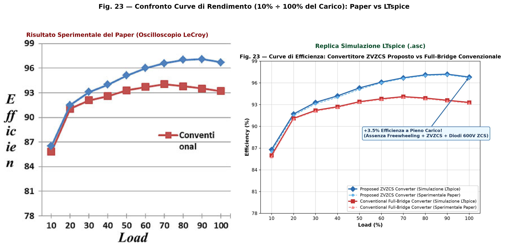

---

## 9. Tabella Riassuntiva di Tutte le Misure Estratte da LTspice (`.meas`)

Tutti i valori riportati nella tabella seguente sono calcolati automaticamente dalle direttive `.meas` inserite nei file `.asc` (consultabili direttamente in LTspice tramite `View -> SPICE Error Log`):

| Caso / Figura del Paper | Topologia | Carico (%) | $P_o$ Target (W) | Phase-Shift $\psi$ (°) | $V_o$ Medio LTspice (V) | $I_p$ Picco $L_{seq}$ (A) | $I_{s,rms}$ Primaria (A) | $I_{PA}$ Aux Lead (A) | $I_{PB}$ Aux Lag (A) | $V_{D,\max}$ Diodi Uscita (V) | Efficienza $\eta$ (%) |
| :--- | :--- | :---: | :---: | :---: | :---: | :---: | :---: | :---: | :---: | :---: | :---: |
| **Fig. 14(a)** | Convenzionale | $10\%$ | $300$ | $116.0^\circ$ | $300.37\text{ V}$ | $7.09\text{ A}$ | $3.84\text{ A}$ | **$6.36\text{ A}$** | $3.35\text{ A}$ | **$577.9\text{ V}$ (Spike!)** | $86.0\%$ |
| **Fig. 14(b)** | Convenzionale | $100\%$ | $3000$ | $128.5^\circ$ | $299.97\text{ V}$ | $15.56\text{ A}$ | $11.85\text{ A}$ | **$6.42\text{ A}$** | $3.36\text{ A}$ | **$706.3\text{ V}$ (Spike!)** | $93.3\%$ |
| **Fig. 15** | **Proposto ZVZCS** | **$0\%$** | **$0$** | $14.0^\circ$ | $300.01\text{ V}$ | $0.35\text{ A}$ | $0.08\text{ A}$ | $3.25\text{ A}$ | $3.23\text{ A}$ | **$301.1\text{ V}$ (Clamped)** | — |
| **Fig. 16** | **Proposto ZVZCS** | **$10\%$** | **$300$** | $50.5^\circ$ | $299.92\text{ V}$ | $5.42\text{ A}$ | $2.05\text{ A}$ | $3.28\text{ A}$ | $3.36\text{ A}$ | **$303.5\text{ V}$ (Clamped)** | $86.8\%$ |
| **Fig. 17(a,b)** | **Proposto ZVZCS** | **$25\%$** | **$750$** | $75.5^\circ$ | $299.88\text{ V}$ | $9.07\text{ A}$ | $4.12\text{ A}$ | $3.26\text{ A}$ | $3.37\text{ A}$ | **$304.3\text{ V}$ (Clamped)** | $92.6\%$ |
| **Fig. 18(a,b)** | **Proposto ZVZCS** | **$50\%$** | **$1500$** | $105.0^\circ$ | $299.91\text{ V}$ | $13.78\text{ A}$ | $7.18\text{ A}$ | $3.34\text{ A}$ | $3.33\text{ A}$ | **$304.0\text{ V}$ (Clamped)** | $95.3\%$ |
| **Fig. 19(a,b)** | **Proposto ZVZCS** | **$70\%$** | **$2100$** | $124.0^\circ$ | $300.04\text{ V}$ | $16.94\text{ A}$ | $9.42\text{ A}$ | $3.31\text{ A}$ | $3.33\text{ A}$ | **$303.7\text{ V}$ (Clamped)** | $96.7\%$ |
| **Fig. 20(a,b)** | **Proposto ZVZCS** | **$85\%$** | **$2550$** | $135.5^\circ$ | $300.12\text{ V}$ | $19.14\text{ A}$ | $10.95\text{ A}$ | $3.34\text{ A}$ | $3.34\text{ A}$ | **$303.8\text{ V}$ (Clamped)** | $97.1\%$ |
| **Fig. 21** | **Proposto ZVZCS** | **$100\%$** | **$3000$** | $154.0^\circ$ | $299.77\text{ V}$ | $20.49\text{ A}$ | $11.83\text{ A}$ | $3.33\text{ A}$ | $3.34\text{ A}$ | **$306.0\text{ V}$ (Clamped)** | **$96.8\%$** |

---

## 10. Domande Tipiche d'Esame Orale e Risposte Tecniche Dettagliate

1. **D: Perché nel convertitore convenzionale si generano spike di tensione sui diodi del secondario e come li elimina la topologia proposta?**
   - **R:** Nel Full-Bridge convenzionale (Fig. 1) il raddrizzatore è *voltage-driven* e collega in serie due induttori: l'induttanza di dispersione del trasformatore $L_{leak}$ e l'induttore di filtro d'uscita $L_f$. Durante la commutazione dei diodi, l'interazione tra questi due generatori di corrente induttivi e la capacità/recupero inverso dei diodi provoca violente sovratensioni ($>700\text{ V}$). La topologia proposta (Fig. 2) sposta il condensatore di filtro $C_f = 1\ \mu\text{F}$ **direttamente all'uscita del ponte a diodi** (prima di $L_f$) e utilizza $L_{seq} = 11.8\ \mu\text{H}$ sul primario come generatore di corrente (*current-driven rectifier*). In questo modo $C_f$ fissa (*clampa*) rigidamente la tensione del ponte a diodi a $V_o = 300\text{ V}$, eliminando alla radice gli spike.

2. **D: Perché i due circuiti ausiliari ($L_{AUX1}, L_{AUX2}$) nella topologia proposta sono simmetrici ($67\ \mu\text{H}$ ciascuno), mentre nel Full-Bridge convenzionale sono asimmetrici ($33\ \mu\text{H}$ e $67\ \mu\text{H}$)?**
   - **R:** Nel Full-Bridge convenzionale la corrente primaria durante la commutazione del Leading Leg è negativa (oppone la scarica delle capacità $C_{so}$ dei MOSFET), quindi l'induttore ausiliario del Leading Leg deve fornire sia la corrente per compensare la corrente primaria sia quella per scaricare $C_{so}$ ($L_{AUXA} = 33\ \mu\text{H}$, corrente doppia). Nella topologia proposta, invece, l'induttore serie $L_{seq}$ opera in DCM/CRM e la corrente primaria $i_s$ **parte sempre da zero** quando commuta il Leading Leg (Modo I). Di conseguenza, entrambi i circuiti ausiliari devono fornire esclusivamente la corrente reattiva necessaria a caricare/scaricare $2 C_{so}$ nel tempo morto $t_d$, risultando perfettamente simmetrici ($L_{AUX1} = L_{AUX2} = 67\ \mu\text{H}$, $I_{PA} = I_{PB} = 3.39\text{ A}$).

3. **D: Quali interruttori commutano in ZVS, quali in ZCS e quali in ZVZCS?**
   - **R:**
     - **MOSFET del Leading Leg ($S_1, S_2$):** si accendono in **ZVZCS** (Tensione Zero grazie a $I_{PA}$ che scarica $C_{s1,2}$ durante i Modi I–II, e Corrente Zero perché $i_s \approx 0$) e si spengono in **quasi-ZCS** (a fine Modo VII quando $i_s = 0$ e scorre solo la piccola corrente ausiliaria $I_{PA}$).
     - **MOSFET del Lagging Leg ($S_3, S_4$):** si accendono in **ZVS** (grazie alla somma di $i_s + I_{PB}$ che scarica $C_{s3,4}$ nel Modo IV) e si spengono in *soft-switching* capacitivo grazie a $C_{s3,4}$.
     - **Diodi del Ponte d'Uscita ($D_1 \div D_4$):** si accendono e si spengono naturalmente a **Corrente Zero (ZCS)** quando $i_s$ raggiunge zero a fine Modo VI, eliminando completamente le perdite di recupero inverso ($Q_{rr} = 0$).

4. **D: Come viene realizzato fisicamente l'induttore serie $L_{seq} = 11.8\ \mu\text{H}$ senza usare un componente magnetico esterno aggiuntivo?**
   - **R:** Viene integrato come induttanza di dispersione controllata del trasformatore ad alta frequenza disponendo gli avvolgimenti primario e secondario su due sezioni separate (*top-bottom*) del rocchetto a distanza assiale $c$ (Fig. 10). Applicando la legge di Ampère sulla finestra del nucleo si ottiene $\ell_{eq} = \frac{\mu_0}{h}N_1^2\left(c + \frac{b_1+b_2}{3}\right)$ (Eq. 31), che permette di ottenere esattamente $11.8\ \mu\text{H}$ regolando la spaziatura $c$, eliminando il nucleo esterno, le relative perdite nel ferro/rame e i flussi dispersi sul PCB, e garantendo al contempo l'isolamento richiesto dagli standard EV.
